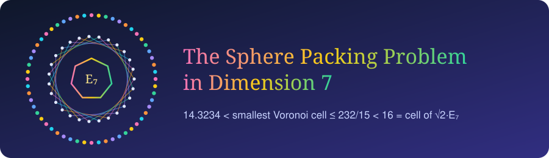

<p align="center"></p>

<p align="center">
<a href="papers/D7Paper.pdf"></a>


<a href="https://doi.org/10.5281/zenodo.24153132"></a>
</p>

**Paper:** [papers/D7Paper.pdf](papers/D7Paper.pdf) · D. Bhattacharjee, U. Bhattacharya, S. Bhattacharya · DOI [10.5281/zenodo.24153132](https://doi.org/10.5281/zenodo.24153132)

| | |
|---|---|
| every Voronoi cell of a unit-ball packing of R⁷ | volume > 14.3234 |
| cell with extra balls beyond the 56 deep holes of √2·E₇ | 232/15 = 15.4667 |
| smallest cell around the E₇ kissing configuration | exactly 232/15 |
| cell of √2·E₇ | 16 |

So the density π³/105 of E₇ cannot be proved cell by cell; whether it is optimal in dimension 7 is open.

### Run the checks

```bash
cd julia && julia --project=. -e 'using Pkg; Pkg.instantiate()' && julia --project=. runall.jl
cd lean  && lake build
```

`julia/` — exact rational polytope computations (cddlib, GMP) and the solid angle Ω₇; outputs in `julia/output/`.
`lean/` — Lean 4 checks of the roots, deep holes and distances (no dependencies).

MIT License.
